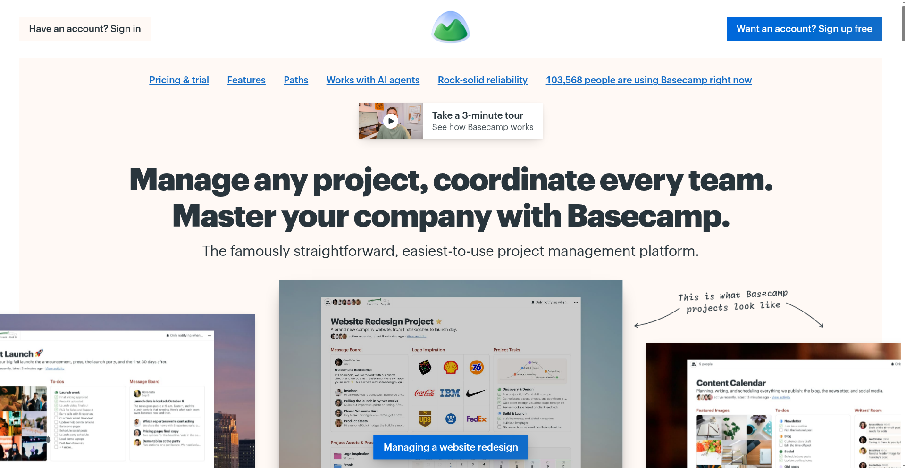
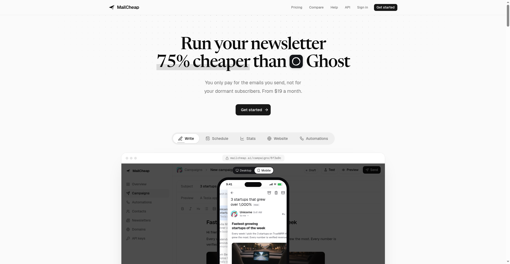
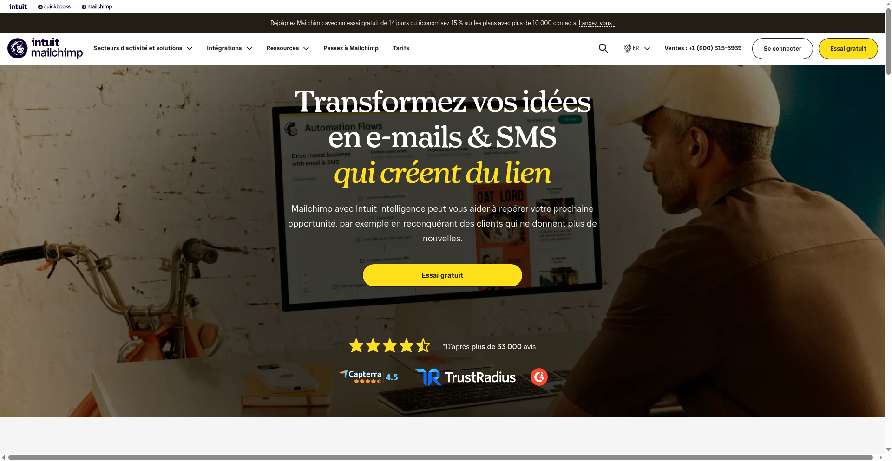
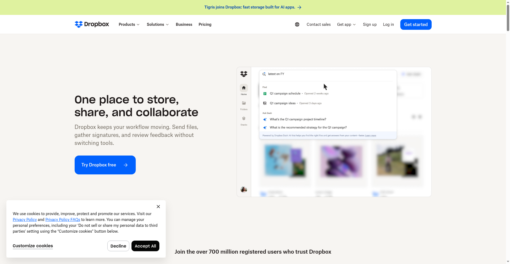
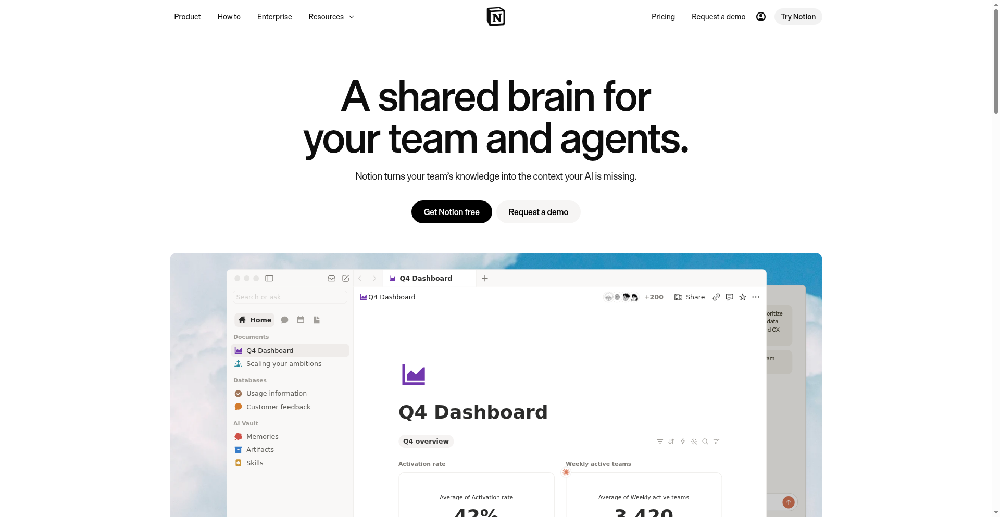
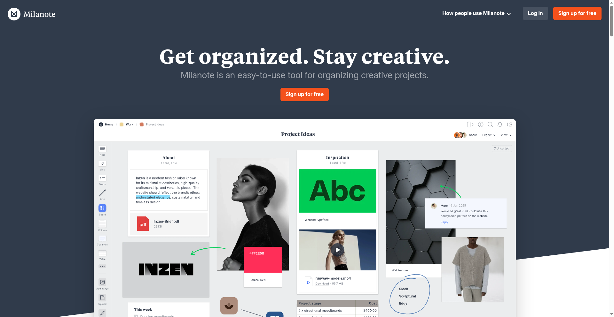
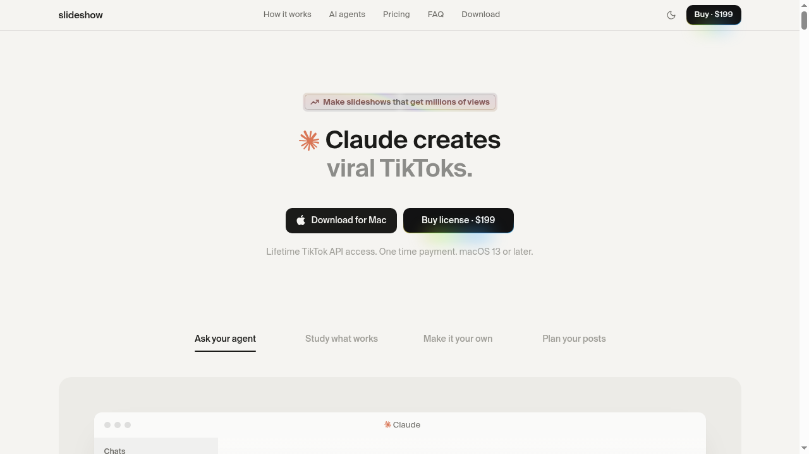
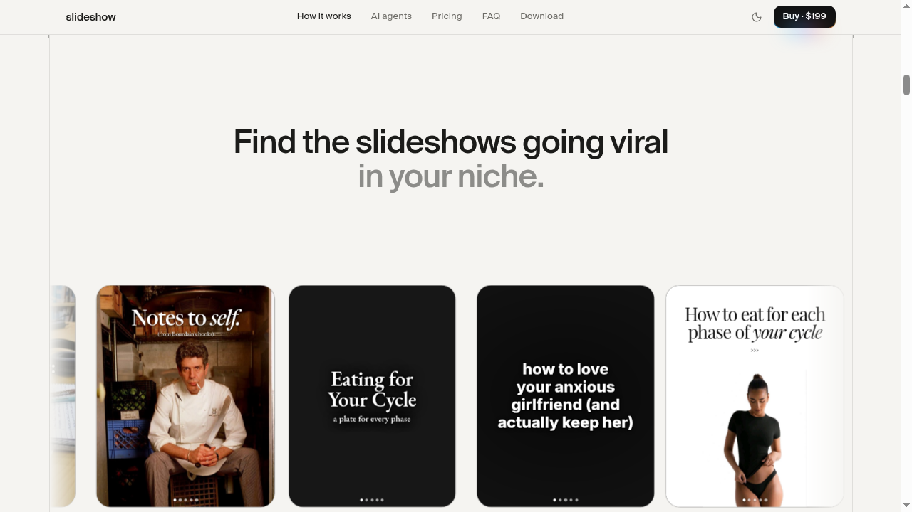
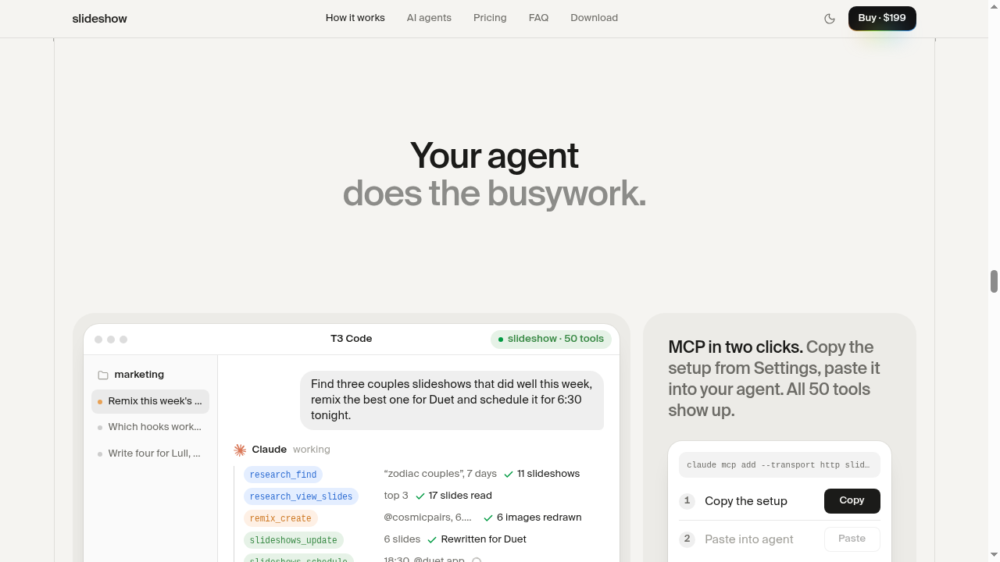
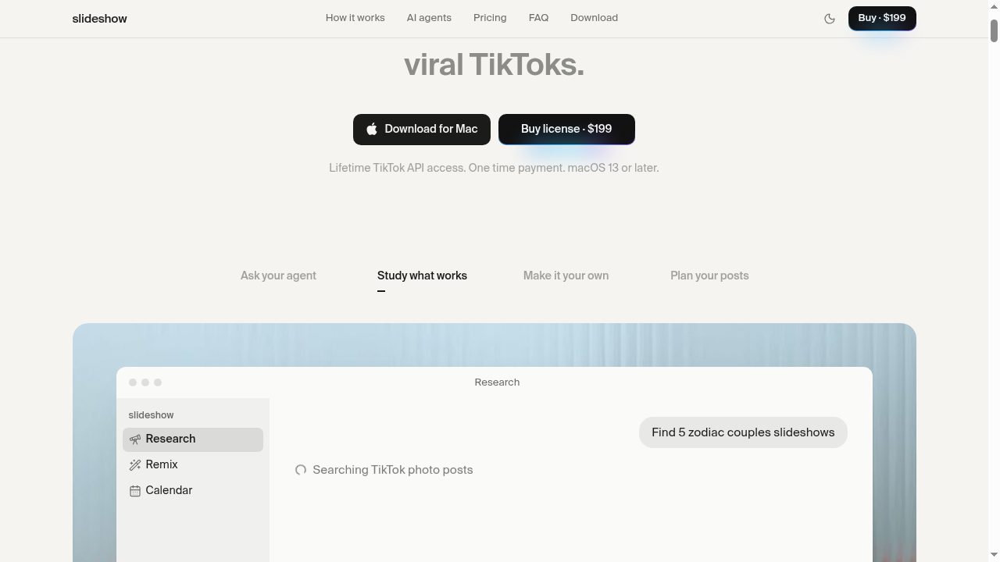

# Inspirations pour la reprise de Coheld

Captures du 23 novembre 2026. Les captures sont des références de composition et non des ressources autorisées à intégrer au produit. Aucun code ni visuel tiers ne reçoit une licence par sa présence dans ce dossier.

## Provenance

Louis a partagé Basecamp, Mailcheap et Mailchimp. Dropbox, Notion et Milanote ont été proposés dans la recherche visuelle précédente. Slideshow est la référence récente de finition, analysée dans COHELD-REPRISE.md. Les propositions ci-dessous ne remplacent pas les exigences de ce dernier dossier.

Les six captures ci-dessous proviennent du brief visuel déjà remis : https://files.instinct.com/tpdz3ulrsqf6-six-pistes-visuelles-pour-coheld . Elles ont été inspectées à nouveau pour cette mise en dépôt. Les animations décrites dans ce brief ne sont pas prouvées par les images fixes.

## Basecamp

https://basecamp.com/

Constat du brief précédent : Des projets montrés en grand, une annotation dessinée et des exemples concrets.

Piste pour Coheld : Montrer des projets Coheld avec des documents, des personnes et une activité visible. Faire comprendre le travail avant de l’expliquer.

À éviter : Ne pas reprendre la longueur de la page ni sa profusion de projets.

## Mailcheap

https://mailcheap.ai/

Constat du brief précédent : Un titre court, des onglets et une démonstration animée de l’interface, avec aperçu mobile.

Piste pour Coheld : Une démonstration Coheld en trois étapes : choisir, transmettre, réutiliser. Chaque étape fait réellement changer le visuel.

À éviter : Pas de promesses commerciales ou de métriques empruntées. Le scénario reste une simulation.

## Mailchimp

https://mailchimp.com/fr/

Constat du brief précédent : Une grande image de situation, un contraste typographique marqué et une action nette.

Piste pour Coheld : Alterner démonstration, composition illustrée et aperçu produit. Varier les échelles plutôt que répéter des cartes identiques.

À éviter : Ni jaune, ni photo générique en fond, ni menu chargé : Coheld reste noir et blanc.

## Dropbox

https://www.dropbox.com/

Constat du brief précédent : Le produit est visible dès l’accueil : fichiers, aperçus et recherche.

Piste pour Coheld : Faire du dossier un objet visuel : miniature de brief, décision, document et source. Dans l’app, privilégier recherche, listes et métadonnées.

À éviter : Ne pas faire passer Coheld pour un disque partagé ou une synchronisation automatique.

## Notion

https://www.notion.com/

Constat du brief précédent : Un récit animé relie documents, contexte, assistants et travail d’équipe. Une commande permet de mettre en pause.

Piste pour Coheld : Raconter une action bout en bout, avec des symboles sobres, une progression et un résultat lisible. Prévoir pause, rejeu et mode sans animation.

À éviter : Ne pas copier son identité ni laisser croire que les intégrations Coheld existent déjà.

## Milanote

https://milanote.com/

Constat du brief précédent : Des images, notes, pièces jointes et liens composent un espace de travail reconnaissable.

Piste pour Coheld : Montrer la variété du contexte : documents, décisions, images et liens, dans une composition éditoriale plutôt qu’un mur de texte.

À éviter : Pas de tableau infini ni de disposition libre à reconstruire dans Coheld.

## Slideshow

https://slideshow.sh/

Voir COHELD-REPRISE.md pour l’analyse détaillée et les exigences de mouvement.

